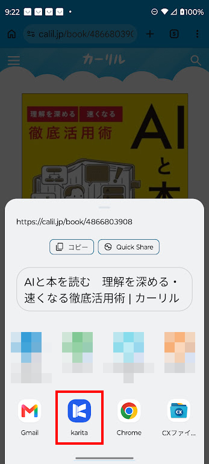

# Android版クローズドテストに参加する

このページはクローズドテスト参加者向けの暫定手順です。テスト終了後に削除します。Windowsを使っていない方も参加できます。

## 1. テストに参加してインストールする

**①〜③は、Android端末のGoogle Playで使用している同じGoogleアカウントで行ってください。**

1. [karita Android テスターのGoogleグループ](https://groups.google.com/g/karita-android-testers)を開き、グループに参加します。
2. [Google Playのテスト参加ページ](https://play.google.com/apps/testing/net.getperf.karita)を開き、テストへの参加を確定します。
3. 参加画面にあるGoogle Playへのリンクからkaritaをインストールします。

**Googleグループへの参加だけでは、テスト参加は完了しません。** 必ず②の手続きを行ってください。

参加できない場合は、グループ・テスト参加ページ・Google Playで選んでいるアカウントを確認してください。解決しない場合は、表示されたメッセージを募集元のDiscordスレッドでお知らせください。

## 2. karitaを起動する

### Androidで初めて使う方

karitaを起動し、画面の案内に沿って初回設定を進めます。Google Driveでの同期には、ご自身のGoogleアカウントを使用します。

初回設定後、「予約」「貸出し」「本棚」の各メニューをお試しください。実際に図書館で本を借りなくても操作を試せます。

Windowsをご利用の方は、[Windowsのセットアップ](guide/windows/setup.md)と[Androidを2台目として追加する手順](guide/android/second-device.md)をご覧ください。

## 3. 操作を試して感想を送る

テスト参加を確定してから14日間以上、テスト参加とGoogleグループへの加入を継続し、アプリもインストールしたままにしていただけると助かります。

感想・不具合は募集元のDiscordスレッドへの返信でお願いします。アプリの版、端末・Androidの版、操作手順、表示されたメッセージを添えると確認しやすくなります。画像の個人情報は隠してください。

期間中に何度か、次の操作をお試しください。

### 予約

- ［カーリルで探す］から本を検索し、本の詳細ページを開きます。
- Chrome右上の［︙］→［共有］→［… もっと見る］→［karita］の順に選びます。
- karitaに表示された本の情報を確認します。実際に予約した本は［予約した］で記録します。

{ width="360" }

共有画面の表示は端末・ブラウザーによって異なります。共有するだけでは、図書館への予約やkaritaへの登録は完了しません。実際に予約していない本は、共有後の情報確認まででも試せます。

[Androidの予約手順](guide/android/reservation.md)

### 貸出し

- 図書館ごとの予約・貸出しの記録を確認します。
- 本の受取・貸出し・返却に合わせて、状態や期限を変更します。
- 図書館サイトの情報は自動取得されないため、確認した内容を手動で記録します。

[貸出しの棚卸をする](guide/loans.md)

### 本棚

- 登録した本を探し、読みたい本や読んだ本の記録を確認します。
- 読了状態、評価、レビューを変更し、保存後に開き直して確認します。

[本棚・レビューを使う](guide/bookshelf.md)

複数端末がある方は、記録の同期もお試しください。

[困ったとき](guide/troubleshooting.md) ／ [ガイドの入口](guide/index.md)
