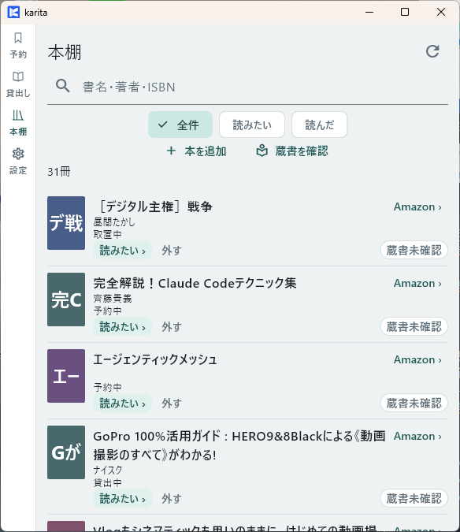
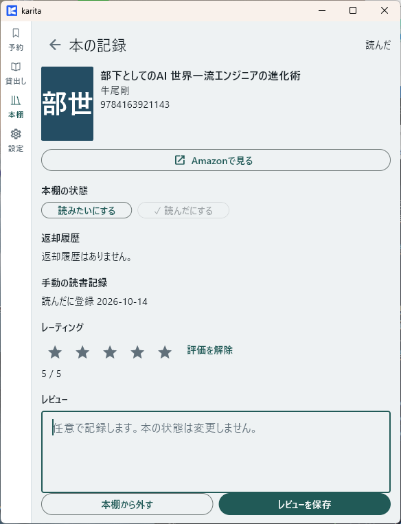

# 本棚・レビューを使う

この操作は **karita 内で完結**します。

## 本を探す

**【karita】** 「本棚」を開き、書名・著者・ISBNで検索するか、［読みたい］［読んだ］で絞り込みます。

{ width="360" }

## レビューを保存する

1. **【karita】** 対象の本を開きます。
2. 本棚の状態を確認し、必要なら「読んだ」にします。
3. レーティングとレビューを入力し、［レビューを保存］を押します。
4. 一覧へ戻り、同じ本を開き直して保存内容を確認します。

{ width="360" }

[ガイドの入口へ](index.md)

[困ったとき](troubleshooting.md)
