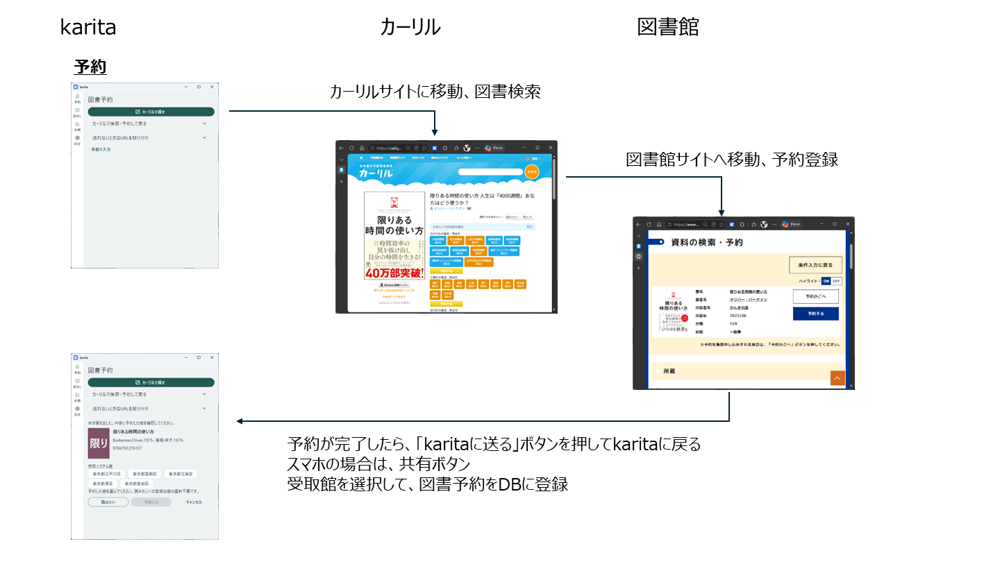

# karita の使い方

karita、カーリル、図書館サイトを行き来して、本を探し、予約し、その結果を記録します。まず、本を1冊予約する流れを紹介します。

## 本を予約する流れ

セットアップが済んだ状態での例です。表の **①〜⑤** の順に進みます。カーリルと図書館サイトはブラウザーで操作します。

<table>
<thead><tr><th scope="col">karita</th><th scope="col">カーリル</th><th scope="col">図書館サイト</th></tr></thead>
<tbody>
<tr><td><strong>①</strong> ［カーリルで探す］を開く</td><td></td><td></td></tr>
<tr><td></td><td><strong>②</strong> 本を探し、所蔵する図書館を確認する</td><td></td></tr>
<tr><td></td><td><strong>③</strong> 予約へのリンクを開く</td><td>ログインして予約を確定する</td></tr>
<tr><td><strong>⑤</strong> 本・図書館を確認し、［予約した］で記録する</td><td><strong>④</strong> 元の本の情報を karita に送る</td><td></td></tr>
</tbody>
</table>

Windows では拡張機能から元のカーリル書籍を送ります。Android では元のカーリルの本の詳細ページに戻り、ブラウザーの共有から送ります。詳しくは [Windows の予約手順](windows/reservation.md)・[Android の予約手順](android/reservation.md)を参照してください。

### 画面で見る予約の流れ

[{ .karita-overview-image width="480" }](../img/guide/reservation-overview.png)

予約時の画面遷移の例です。操作の順序は上の表を参照してください。図を押すと原寸で確認できます。

## 予約した後の流れ

**図書館での手続きと、karita への記録は別の操作です。** 本を送るだけでは、予約や貸出状況は自動更新されません。

予約後も、図書館での受取・返却や、図書館サイトで確認した状態・期限に合わせて、karita の記録を更新します。

- **受取・貸出し・返却の記録**：[貸出しの棚卸をする](loans.md)
- **読んだ本や感想の記録**：[本棚・レビューを使う](bookshelf.md)

## 初めて使う

1. [Windows のセットアップ](windows/setup.md)
2. [図書を予約する](windows/reservation.md)
3. [Android を2台目として追加する](android/second-device.md)

## 目的から探す

- [設定を変更する](settings.md)
- [同期・バックアップ・復元](data.md)
- [Android で図書を予約する](android/reservation.md)
- [困ったとき](troubleshooting.md)

各手順の **【karita】**・**【ブラウザー】** が操作場所です。ページ冒頭のフローで全体を見てから、番号順に進めてください。
