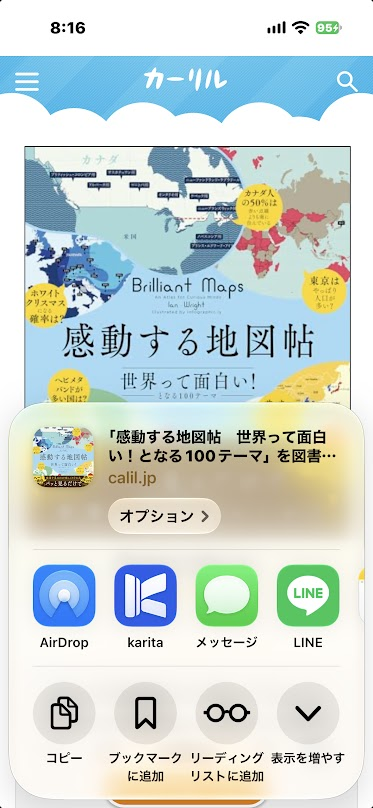
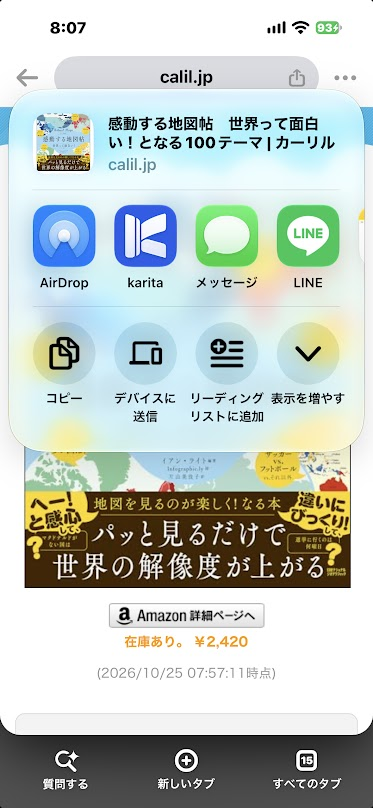

# スマホ（iPhone）を追加する

**ゴール：iPhone で karita を使い始め、ブラウザーの共有から本を送って予約を記録できる状態にします。**

<b>iPhone</b> インストール・Google アカウントでサインイン
↓

<b>iPhone の karita</b> 新しく始める、または［合流する］
↓

<b>iPhone の共有メニュー</b> karita をよく使う項目に入れる
↓

<b>ブラウザーの共有 → karita</b> 本を送り、予約を記録する

Windows・Android をお使いでない方も、iPhone だけで使えます。

## 1. インストールする

**【iPhone】** App Store で「karita - 図書館の本と予約をまとめて管理」をインストールします。

App Store での公開は準備中です。公開までは、テスト参加者に TestFlight で配布しています。テストに参加している方は、招待メールの案内に従って TestFlight アプリからインストールしてください。

## 2. karita を始める

1. **【iPhone の karita】** karita を起動し、［サインイン］を押します。
2. **【Google の認証画面】** 同期に使う Google アカウントでサインインし、Google ドライブのアプリ専用領域へのアクセスを許可します。
3. **【karita】** 画面の案内に沿って進みます。

Windows・Android の記録を iPhone でも使う場合は、**同じ Google アカウント**でサインインし、「今の記録に合流する（おすすめ）」の［合流する］を選んで同期を待ちます。バックアップ復元は不要です。先に、使っている端末の karita で同期が完了していることを確かめてください。

[記録が出ない・変更が反映されないとき](../troubleshooting.md#sync)

## 3. 共有メニューに karita を出す {#share-setup}

iPhone では、ブラウザーの共有メニューから karita へ本を送ります。最初は karita がアプリの列の［その他］の中にあることが多いため、先頭に出しておくと操作が楽になります。設定は端末ごとに一度だけです。

1. **【ブラウザー】** Safari または Chrome で任意のページを開き、共有を開きます。
2. アプリの列を右端まで送り、［その他］を押します。
3. 右上の［編集］を押し、「候補」の karita の［＋］を押して「よく使う項目」に入れます。
4. 並べ替えのつまみで karita を上に移動し、［完了］を押します。

よく使う項目に入れると、Safari でも Chrome でも、共有メニューの最初の画面に karita が並びます。

## 4. 図書を予約する {#share}

1. **【karita】** 「予約」から［カーリルで探す］を開きます。
2. **【ブラウザー：カーリル】** 本を検索し、利用する図書館の予約へのリンクから進みます。
3. **【ブラウザー：図書館サイト】** ログインして予約を確定し、完了を確認します。
4. **【ブラウザー：カーリル】** 元の本の詳細ページに戻り、共有から［karita］を選びます。
5. **【karita】** 本・図書館を確認し、［予約した］を押します。「貸出し」の［予約中］に表示されれば完了です。

共有の開き方はブラウザーによって異なります。画面例は、karita をよく使う項目に入れた状態です。

=== "Safari"

    画面下の［…］→［共有］を開き、アプリの列の［karita］を選びます。

    { width="320" }

=== "Chrome"

    アドレスバー右端の共有ボタンを押し、アプリの列の［karita］を選びます。

    { width="320" }

**本の詳細ページを表示した状態で共有してください。** Chrome でページを開いていない状態から共有すると、Chrome の紹介が送られ、karita に「何をしますか？」と表示されます。その場合はキャンセルし、本の詳細ページから送り直してください。

**共有しただけでは登録は完了せず、図書館の予約・貸出状況も自動更新されません。** 共有できない場合は、本の詳細ページの URL をコピーし、karita の予約画面の［送れないときはURLを貼り付け］に貼り付けて取り込めます。

## 5. 操作を試す

- **受取・貸出し・返却の記録**：[貸出しの棚卸をする](../loans.md)
- **読んだ本や感想の記録**：[本棚・レビューを使う](../bookshelf.md)
- **アカウント・表示の設定**：[設定を変更する](../settings.md)。iPhone では設定の［サインアウト］で、この端末の接続を解除できます。

[困ったとき](../troubleshooting.md) ／ [ガイドの入口](../index.md)
