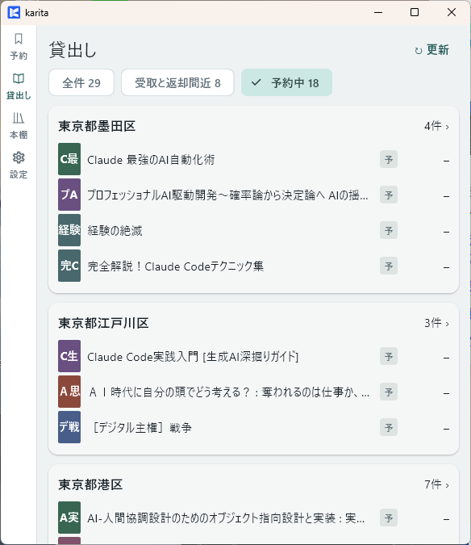
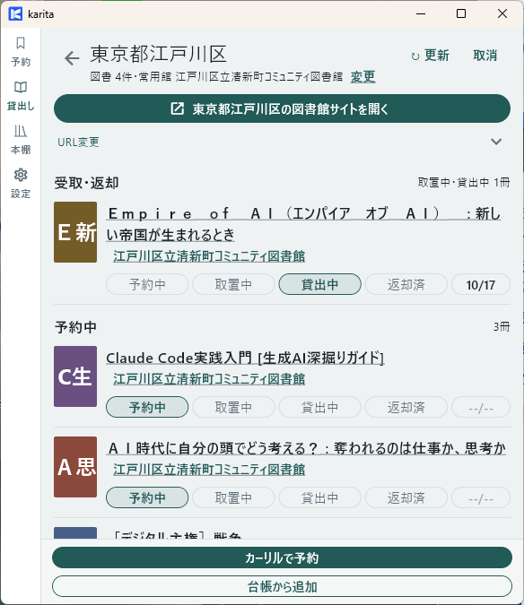

# 貸出しの棚卸をする

画面例・操作はWindows版を標準に説明しています。Android・iPhoneの共有やアプリの切り替えは[スマートフォンでの操作](smartphone.md)を参照してください。

図書館サイトと照合して、受取・貸出し・返却の記録を更新します。

<b>① karita</b> 各図書館の貸出し状況を見る。貸出しから図書館を選ぶ
↓ ［図書館サイトを開く］

<b>② ブラウザー：図書館サイト</b> 予約状況・貸出中の本・期限を確認
↓ karita に戻る

<b>③ karita</b> 確認した状態と期限を手動で更新 <strong>戻るだけでは自動更新されません。</strong>

!!! warning "karita に戻った後、手動で更新してください"
    「karita に送る」で戻っても、図書館サイトの貸し出し情報は自動で反映されません。**本ごとに状態・期限を確認し、karita の記録を手動で更新する必要があります。**

## 1. 各図書館の貸し出し状況を見る

**【karita】** 「貸出し」を開き、各図書館の貸し出し一覧を表示します。
以下で絞り込み検索が可能です。

| 確認したいこと | 絞り込み |
|---|---|
| 図書館の記録をまとめて照合 | 全件 |
| 取り置き・返却期限が近い本 | 受取と返却間近 |
| 貸出し中の本 | 貸出し中 |
| 予約した本 | 予約中 |

<!-- { width="360" } -->

## 2. 実際の状況を確認する

確認する図書館を選び、詳細画面に進みます。

**【karita → ブラウザー：図書館サイトを開く】** ［図書館サイトを開く］を押し、ログインして予約状況・貸出中の本・返却期限を確認します。

図書館サイトの［更新］や［延長］などの手続きが必要なら、そこで完了させます。

## 3. karita の記録を更新する

**【ブラウザー → karita】** 次のいずれかの方法で、karita の貸出し画面に戻ります。

- **「karita に送る」を使う**：ブラウザーのツールバーで「karita に送る」を開き、［貸出し画面（図書館別）に移動］を選びます。[貸出し画面へ戻れないとき](troubleshooting.md#records)を確認してください。
- **タスクスイッチで切り替える**：Windows の Alt＋Tab で karita を選び、確認していた図書館の貸出し画面に戻ります。

切り替えただけでは、図書館サイトの状況は karita に反映されません。確認した内容を次の操作で記録します。

{ width="360" }

**【karita】** 本ごとに、確認した状態を選びます。

| 図書館で確認したこと | karita に記録する状態 |
|---|---|
| 予約待ち | 予約中 |
| 受取待ち | 取置中 |
| 受け取って借りている | 貸出中。返却期限も確認 |
| 返した | 返却済み。レビュー可能 |

対象の本・状態・期限が図書館サイトと一致すれば完了です。ほかの図書館も同じ順で確認します。

[次へ：本棚・レビューを使う →](bookshelf.md)
