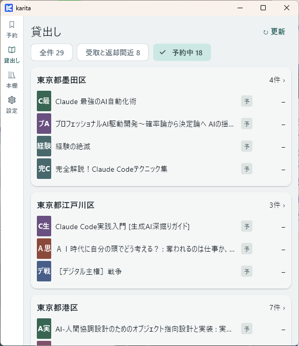
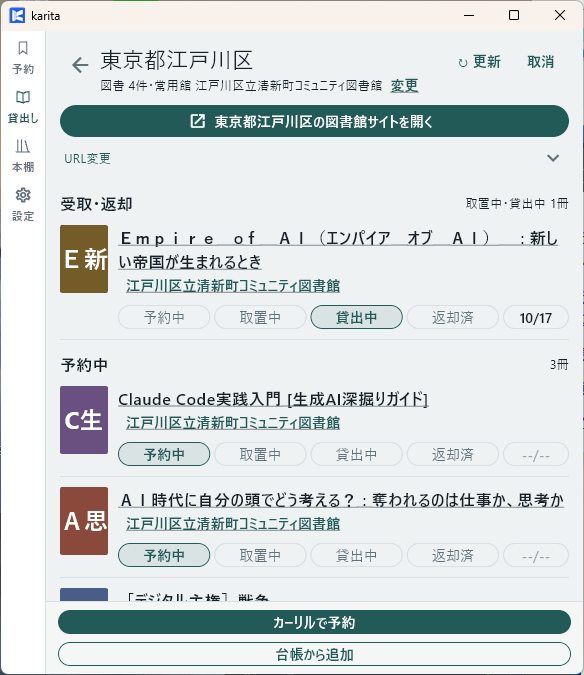

# 貸出しの棚卸をする

図書館サイトと照合して、受取・貸出し・返却の記録を更新します。

!!! note "ドラフト"
    Windows の画面例です。Android の戻り方は実機確認後に補足します。

<b>① karita</b> 貸出しから図書館を選ぶ
↓ ［図書館サイトを開く］

<b>② ブラウザー：図書館サイト</b> 予約状況・貸出中の本・期限を確認
↓ karita に戻る

<b>③ karita</b> 確認した状態と期限を記録

## 1. 確認する図書館を開く

**【karita】** 「貸出し」を開き、対象の図書館を選びます。

| 確認したいこと | 絞り込み |
|---|---|
| 予約した本の状況 | 予約中 |
| 取り置き・返却期限が近い本 | 受取と返却間近 |
| 図書館の記録をまとめて照合 | 全件 |

{ width="360" }

## 2. 実際の状況を確認する

**【karita → ブラウザー：図書館サイト】** ［図書館サイトを開く］を押し、ログインして予約状況・貸出中の本・返却期限を確認します。

図書館サイトの［更新］や［延長］などの手続きが必要なら、そこで完了させます。

## 3. karita の記録を更新する

**【ブラウザー → karita】** タスクバーなどから karita に戻ります。Windows の拡張に［貸出し画面（図書館別）に移動］が表示される場合は、その操作でも戻れます。

{ width="360" }

**【karita】** 本ごとに、確認した状態を選びます。

| 図書館で確認したこと | karita に記録する状態 |
|---|---|
| 予約待ち | 予約中 |
| 受取待ち | 取置中 |
| 受け取って借りている | 貸出中。返却期限も確認 |
| 返した | 返却済み |

対象の本・状態・期限が図書館サイトと一致すれば完了です。ほかの図書館も同じ順で確認します。

[次へ：本棚・レビューを使う →](bookshelf.md)
