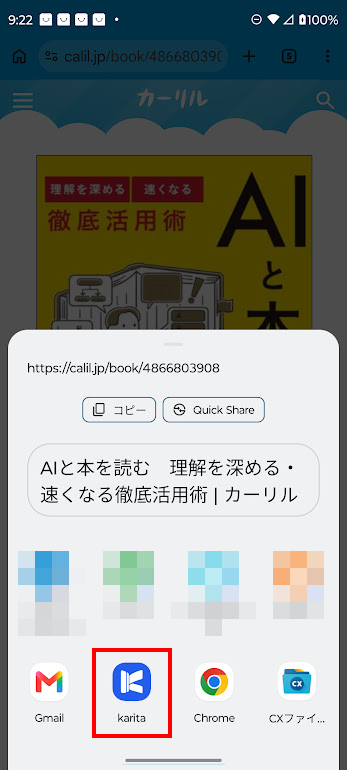
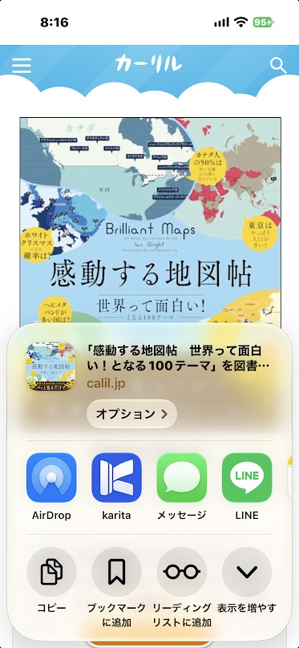
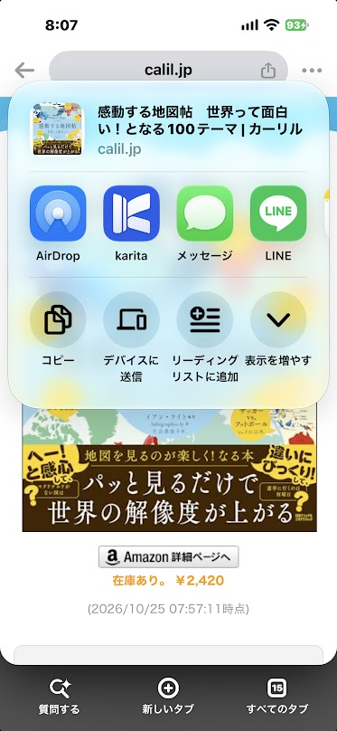

# スマートフォンでの操作

このページでは、Android・iPhoneで本を探して予約を記録する流れと、端末ごとの共有操作を説明します。Windows版は[図書を予約する](windows/reservation.md)を参照してください。

## 予約：本を探して、予約を記録する

1. **karita** の「予約」画面で［カーリルで探す］を押します。
2. **カーリル** で借りたい本を検索し、本の詳細ページを開きます。
3. **karita** に本を送ります。カーリルの本の詳細ページから、[ブラウザーからkaritaに本を送る](#send-book)の手順でkaritaを選びます。
4. **karita** で届いた本を確認し、予約する図書館を選んで図書館サイトを開きます。
5. **図書館サイト** でログインし、案内に従って予約を確定します。予約が完了したことを確認します。
6. **karita** に端末のアプリ切り替えで戻り、本と図書館を確認して［予約した］を押します。「貸出し」の［予約中］に本が表示されれば、記録は完了です。

## ブラウザーからkaritaに本を送る {#send-book}

カーリルの本の詳細ページを表示し、ブラウザーの共有メニューからkaritaに送ります。

### Android {#android}

Chromeの［︙］→［共有］→［… もっと見る］→［karita］を選びます。ブラウザーに共有ボタンがある場合は、そこからも開けます。共有先では個人宛先ではなくアプリのkaritaを選んでください。

{ width="360" }

### iPhone {#iphone}

SafariやChromeで本の詳細ページを表示し、ブラウザーの共有ボタンからkaritaを選びます。見つからない場合は[共有メニューにkaritaを出す](ios/add-device.md#share)を参照してください。

画面例は、karitaを「よく使う項目」に追加した状態です。

=== "Safari"

    Safariの共有メニューから、アプリの列のkaritaを選びます。共有ボタンの位置はSafariの表示によって異なります。

    { width="320" }

=== "Chrome"

    アドレスバー右端の共有ボタンを押し、アプリの列のkaritaを選びます。

    { width="320" }

Chromeではページが表示されるまで待ってから共有してください。新しいタブなどでChrome自体を共有しても、本は届きません。

共有できないときは、本の詳細ページのURLをコピーし、karitaの予約画面へ貼り付けられます。

## 貸出し・返却、本棚を使う

図書館サイトで貸出し状況を確認したら、端末のアプリ切り替えでkaritaに戻ります。

- [貸出し・返却を記録する](loans.md)
- [本棚・レビューを使う](bookshelf.md)

[困ったとき](troubleshooting.md)
