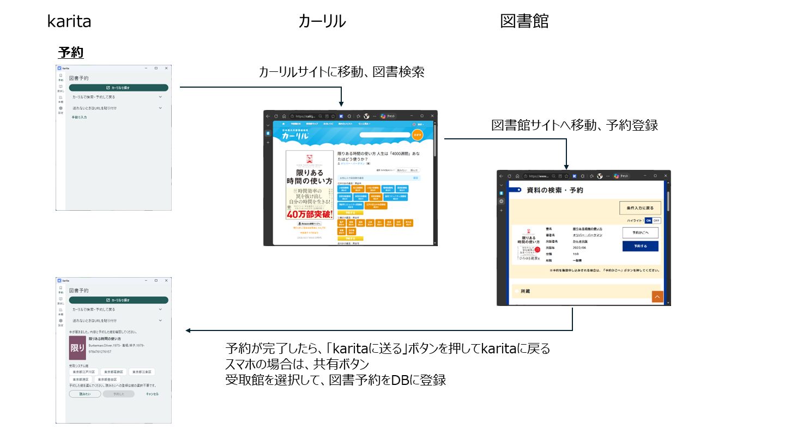
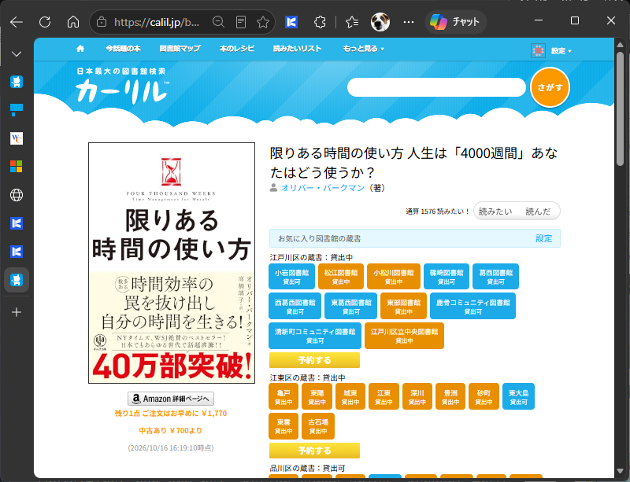
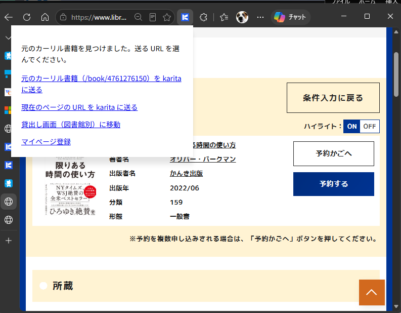
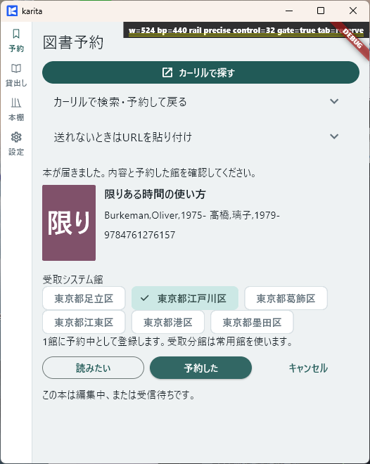

# 図書を予約する

画面例・操作はWindows版を標準に説明しています。Android・iPhoneの共有やアプリの切り替えは[スマートフォンでの操作](../smartphone.md)を参照してください。

**ゴール：図書館で予約を済ませ、同じ本を karita に「予約した」と記録します。**

<b>① karita</b> ［カーリルで探す］
↓ ブラウザーへ

<b>② カーリル</b> 本を検索して、予約する図書館を選択する
↓ 図書館サイトへ

<b>③ 図書館サイト</b> ログインして予約を完了
↓ 拡張で元の本を送る

<b>④ karita</b> 本・図書館を確認し［予約した］

[{ .karita-overview-image width="480" }](../../img/guide/reservation-overview.png)

セットアップが済んだ状態での画面遷移例です。図書館での手続きとkaritaへの記録は別の操作で、状態・期限は自動更新されません。

## 1. 本を探す

**【karita → ブラウザー：カーリルで探す】** 「予約」画面で［カーリルで探す］を押し、借りたい本を検索します。本の詳細を開き、利用する図書館の蔵書を確認します。

カーリル側でも、検索対象の図書館を選びます。**この本の詳細タブは、予約を記録し終えるまで開いたままにしてください。**

{ width="620" }

## 2. 図書館で予約を完了する

**【ブラウザー：予約する、で図書館サイトに進む】** カーリルの予約へのリンクから進み、図書館の利用者番号などでログインします。案内に従い、本・受取館などを確認して予約を確定します。

**図書館サイトで予約が完了したことを確認してから、次へ進みます。** 画面や操作は図書館によって異なります。

## 3. 本を karita に送る

**【ブラウザー → karita：karitaに送る】** ツールバーの「karita に送る」を開き、［元のカーリル書籍を karita に送る］を選びます。アプリを開く確認が出たら許可します。

{ width="620" }

[元の本を選べない・違う本が表示されたとき](../troubleshooting.md#book-handoff)

## 4. 予約したことを記録する

**【karita】** 表示された本と、実際に予約した図書館を確認し、［予約した］を押します。

{ width="360" }

「貸出し」の［予約中］で、対象の本と図書館が見つかれば完了です。次の本も、手順1〜4を繰り返します。

[次へ：貸出しの棚卸をする →](../loans.md) ／ [送れないとき](../troubleshooting.md#book-handoff)
