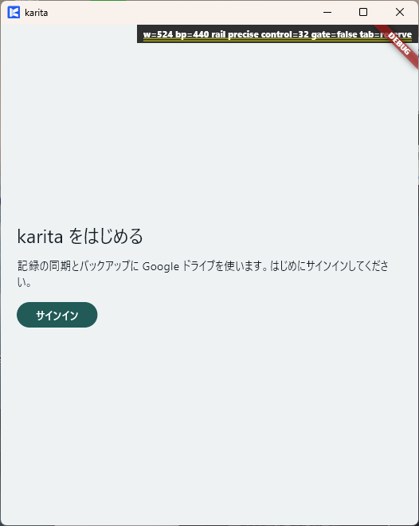
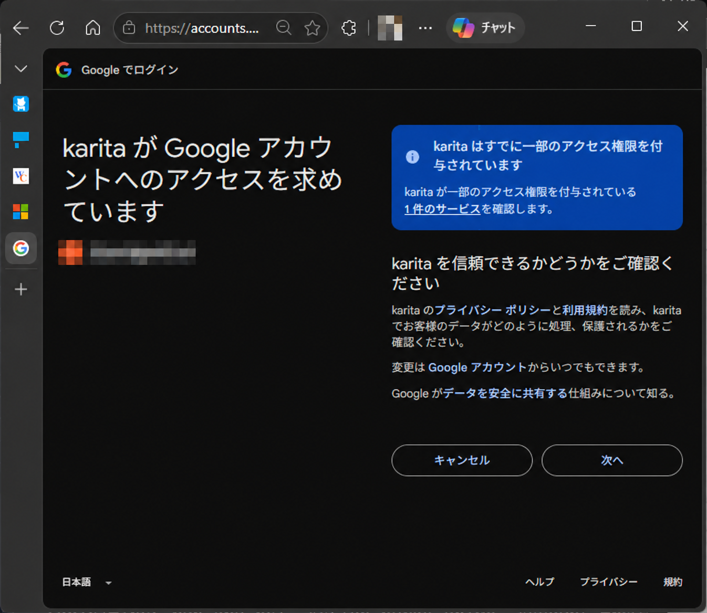
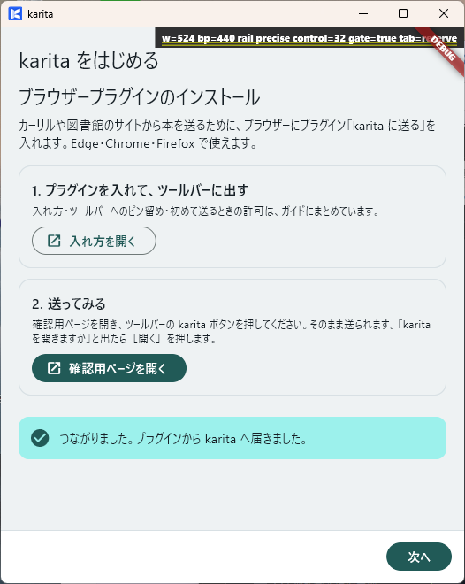

# Windows のセットアップ

!!! note "ドラフト"
    Store の正式な入手先・対象者の案内と、配布版の画面確認を追加予定です。

**ゴール：図書館を登録し、ブラウザーから karita に情報を送れる状態にします。**

<b>Microsoft Store</b> インストール
↓

<b>karita → ブラウザー → karita</b> Google にサインイン
↓

<b>karita</b> 開始方法を選ぶ
↓

<b>ブラウザー → karita</b> 拡張の導入・連携確認
↓

<b>karita</b> 図書館を登録

## 1. インストールする

**【Microsoft Store】** karita の製品ページからインストールし、［開く］で起動します。

準備するものは、記録の同期に使う Google アカウントと、予約先の図書館の利用者番号・パスワードです。Store 用の Microsoft アカウントとは役割が異なります。

## 2. Google にサインインする

1. **【karita】** ［サインイン］を押します。
2. **【ブラウザー：Google】** 使用するアカウントを選び、表示されるアクセス内容を確認して進めます。
3. **【karita】** アプリへ戻り、次の画面が表示されることを確認します。

{ width="360" }

{ width="560" }

Google の画面は、以前の同意状況により異なります。

## 3. 開始方法を選ぶ

**【karita】** 初めて記録を作る場合は［新しく始める］を選びます。既存の記録がある場合は「今の記録に合流する（おすすめ）」の［合流する］を選びます。

旧版で［新しく始める］と表示される場合も、同じ Google アカウントの既存記録を通常の同期で取り込みます。配布版で表示を確認予定です。

［バックアップから始める］は、保存した過去の記録へ戻す場合の操作です。詳しくは[同期・バックアップ・復元](../data.md)を参照してください。

## 4. ブラウザーとつなぐ

1. **【karita】** 「ブラウザープラグインのインストール」で［入れ方を開く］を押します。
2. **【ブラウザー】** [拡張の入れ方](../../extensions/index.md)に従って、導入・ツールバーへの固定・送信確認を行います。
3. **【karita】** 「つながりました」と表示されたら［次へ］を押します。

{ width="360" }

拡張の導入方法・権限・ブラウザー別の操作は、リンク先にまとめています。

## 5. 図書館を登録する

**【karita】** 地区 → 図書館 → 常用館を選び、保存します。利用する地区について繰り返し、［完了］で終了します。

登録後、利用する図書館が選択できればセットアップ完了です。

[次へ：図書を予約する →](reservation.md)
