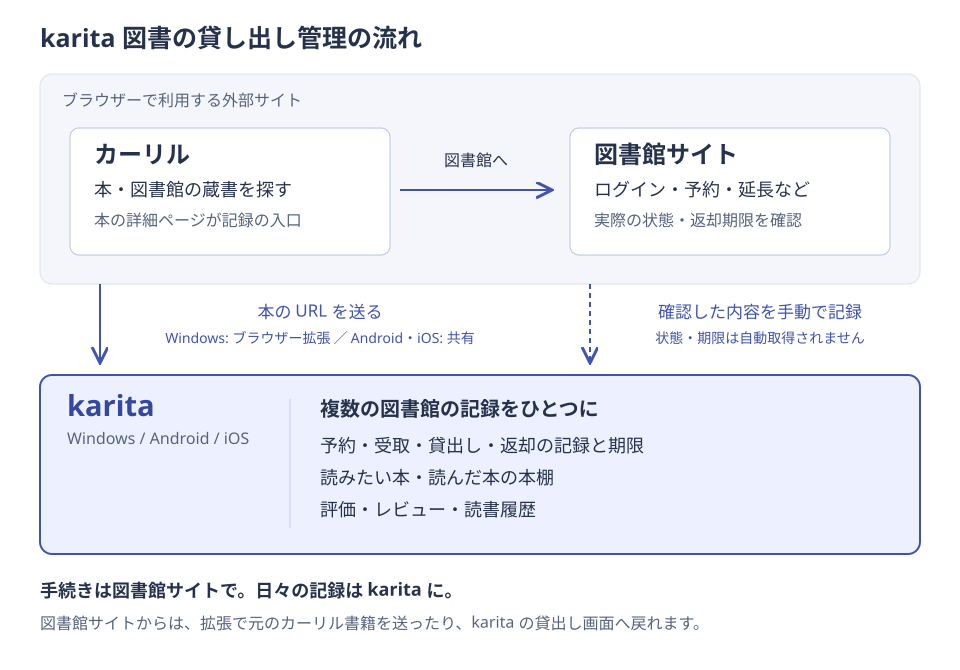

# karita

karita は、複数の図書館の予約・貸出し記録と読書履歴をまとめて管理するアプリです（Windows / Android 対応）。

## karita でできること

- 複数の図書館の予約・貸出し記録と返却期限を、まとめて確認できます。
- 読みたい本・読んだ本を本棚にまとめ、評価やレビューを残せます。
- Windows と Android の間で、記録を同期できます。

## カーリル・図書館サイトとの連携

- カーリルで本や図書館の蔵書を探し、図書館サイトで予約などの手続きを行えます。
- Windows はブラウザー拡張「karita に送る」、Android はブラウザーの共有から、本の URL を karita へ渡せます。
- 図書館サイトで確認した予約・貸出しの状態や期限を、自分で karita に記録して管理します。状態や期限は自動取得されません。

書誌情報はカーリル・openBD へ端末から直接問い合わせます。記録の同期には利用者自身の Google Drive（アプリ専用領域）を使い、開発者独自のサーバーは持ちません。

## 利用案内

- [使い方](guide/index.md)
- [ブラウザー拡張の入れ方](extensions/index.md)
- [プライバシーポリシー](privacy.md)
- [利用規約](terms.md)

---

© 2026 getperf.net
