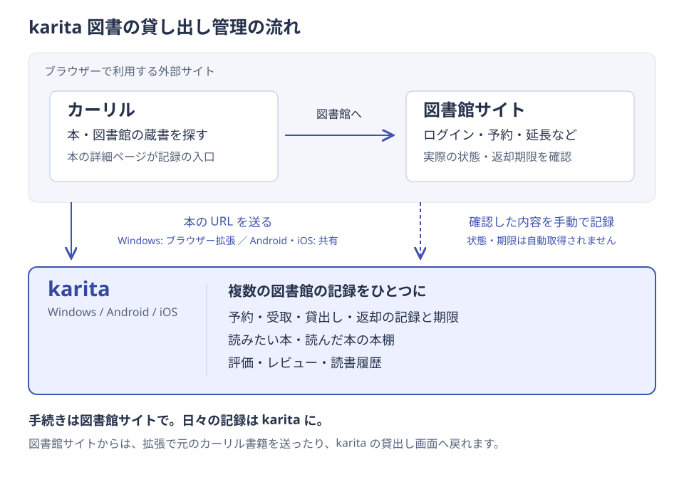

# karita

karita は、複数の図書館の予約・貸出し記録と読書履歴をまとめて管理するアプリです。

[▶ はじめに動画で使い方を見る](https://youtu.be/g-6wYKiPM6M){ .md-button .md-button--primary }

約3分10秒・無音・画面内字幕付き

## karita でできること

- 複数の図書館の予約・貸出し記録と返却期限を、まとめて確認できます。
- 読みたい本・読んだ本を本棚にまとめ、評価やレビューを残せます。
- Windows・Android・iOS の間で、記録を同期できます。

## カーリル・図書館サイトとの連携

- カーリルで本や図書館の蔵書を探し、図書館サイトで予約などの手続きを行えます。
- Windows はブラウザー拡張「karita に送る」、Android・iOS はブラウザーの共有から、本の情報を karita へ渡せます。
- **図書館での手続きと、karitaへの記録は別の操作です。** 本を送るだけでは予約は完了しません。
- **予約・貸出しの状態や期限は自動更新されません。** 図書館サイトで確認した内容を、自分でkaritaに記録します。

記録の同期には利用者自身の Google Drive（アプリ専用領域）を使い、独自のサーバーは持ちません。

## 利用案内

!!! tip "Android版・iPhone版のテスト参加者を募集しています"
    どなたでも参加できます。

    - Android：Google Play のクローズドテスト（[参加方法](closed-test.md)）
    - iPhone：TestFlight の公開テスト（[参加方法](setup/iphone.md#testflight)）

- セットアップ：[Windows](setup/windows.md) ／ [Android](setup/android.md) ／ [iPhone](setup/iphone.md)
- 使い方：予約（[Windows](guide/reserve-windows.md)・[Android・iPhone](guide/reserve-smartphone.md)） ／ [貸出し・返却](guide/loans.md) ／ [本棚・レビュー](guide/bookshelf.md)
- [設定](guide/settings.md) ／ [同期・バックアップ・復元](guide/data.md) ／ [困ったとき](guide/troubleshooting.md)
- [プライバシーポリシー](privacy.md)
- [利用規約](terms.md)

## 感想・お問い合わせ

感想・要望・不具合の報告は、Windows・Android・iPhone 共通の[karita テストのアンケート](https://docs.google.com/forms/d/e/1FAIpQLSc8eWl6bRgsW01X4ZjHz1cAIGV3uSGmEz0dZIQ6MBS0LDBTxQ/viewform)からお送りください。

ご質問：furu3@getperf.net

---

© 2026 getperf.net
