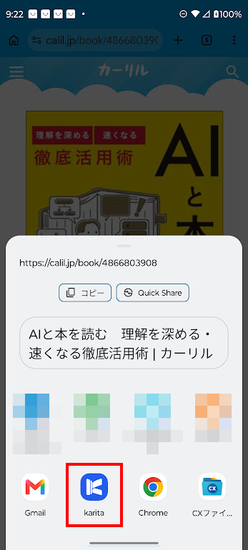

# Android のセットアップ

**クローズドテスト中・一般公開準備中です。** Windowsを使っていない方も参加できます。

<b>① インストールする</b> クローズドテストに参加して Google Play から入れる
↓

<b>② karita を始める</b> Google にサインインし、図書館・常用館を登録する
↓

<b>③ 共有メニューに karita を出す</b> Chrome の共有から本を送れるようにする

## 1. インストールする {#install}

現在はクローズドテストで配布しています。[専用ページの参加・インストール手順](../closed-test.md)を確認してください。

## 2. karita を始める {#start}

karitaを起動し、ご自身のGoogleアカウントでサインインします。

- **初めて使う場合**：［新しく始める］を選び、画面の案内に沿って図書館・常用館を登録します。
- **ほかの端末の記録を使う場合**：元の端末で同期を済ませ、同じGoogleアカウントで［合流する］を選びます。同期後、予約・本棚・図書館の記録が表示されることを確認してください。

端末追加のために初期化やバックアップ復元は行いません。[同期・バックアップ・復元](../guide/data.md)を参照してください。

## 3. 共有メニューに karita を出す {#share}

Androidにはブラウザー拡張がないため、**Chromeの共有**からカーリルの本をkaritaへ送ります。ここでは共有先にkaritaが出ることを確認し、すぐ選べるようにします。

1. **【Chrome】** [カーリル](https://calil.jp/)で本を検索し、本の詳細ページを開きます。
2. ［︙］→［共有］を押し、端末の共有画面を開きます。Chromeの版によっては先にChromeの共有画面が開くので、［… もっと見る］を押します。
3. 共有画面を上へスワイプしてアプリの一覧を広げ、karitaを探します。
4. karitaを長押しし、［karitaを固定］を押します。上段のアプリの列にピンの印付きで並び、次回からすぐ選べます。
5. karitaを押し、karitaの「予約」画面に「本が届きました」と表示されることを確認します。確認だけの場合は、［キャンセル］で閉じてかまいません。

{ width="360" }

設定は端末ごとに一度行います。共有画面の表示や固定の操作は、端末メーカー・Android・Chromeの版によって異なります。固定できない場合も、手順3の一覧からkaritaを選べます。共有先では個人宛先ではなく、アプリのkaritaを選んでください。

## 次へ：本を予約する

[次へ：図書を予約する（Android・iPhone） →](../guide/reserve-smartphone.md)

[困ったとき](../guide/troubleshooting.md#book-handoff)
